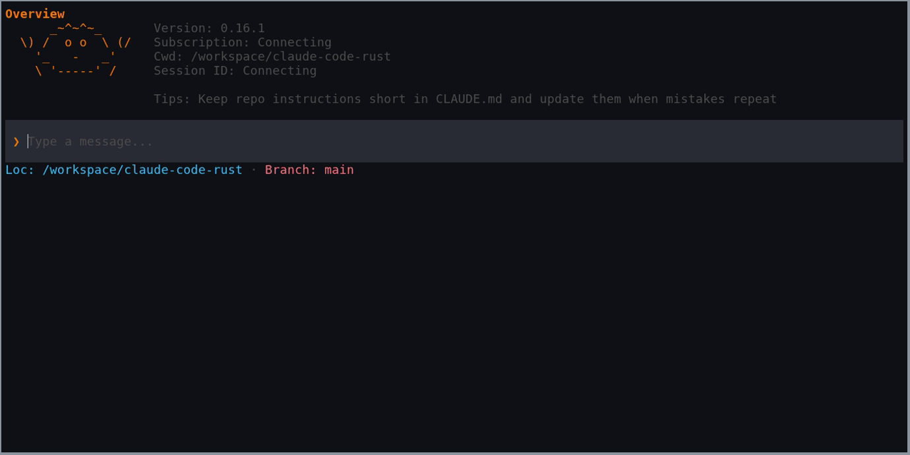

# Claude Code Rust

An alternative terminal frontend for Claude Code, written in Rust. Your conversation stays in your terminal's own scrollback, without flicker.

[](https://github.com/srothgan/claude-code-rust/releases/latest)
[](https://github.com/srothgan/claude-code-rust/actions/workflows/pr.yml)
[](https://srothgan.github.io/claude-code-rust/)
[](https://www.apache.org/licenses/LICENSE-2.0)

## About

Claude Code Rust (`claude-rs`) is a terminal UI for Claude Code built on [Ratatui](https://ratatui.rs/). It runs your sessions through Anthropic's official Agent SDK via a local bridge, with the same account, models, tools, file edits, permissions, MCP servers, skills and session history as Claude Code itself. Only the interface is different.

<p align="center">
  
</p>

## Prerequisite

Install the Claude Code CLI and keep `claude` on `PATH` for some functionality not yet supported by the Anthropic SDK. See the [dependency and feature overview](https://srothgan.github.io/claude-code-rust/about.html#claude-cli-dependencies) for details.

## Install

### Install script (recommended, v0.14.0+)

**macOS/Linux:**

```bash
curl -fsSL https://raw.githubusercontent.com/srothgan/claude-code-rust/main/scripts/install/install.sh | sh
```

**Windows PowerShell:**

```powershell
powershell -NoProfile -ExecutionPolicy Bypass -Command "irm 'https://raw.githubusercontent.com/srothgan/claude-code-rust/main/scripts/install/install.ps1' | iex"
```

<details>
<summary><b>Already have Node.js 24+? Use npm instead</b></summary>

```bash
npm install -g claude-code-rust
```

<sub>The package ships prebuilt platform binaries and its own Bun runtime for the Agent SDK bridge, so no Rust toolchain, Bun install, or `postinstall` script is needed. Node.js 24+ is still required to run the `claude-rs` launcher.</sub>

</details>

See the [installation guide](https://srothgan.github.io/claude-code-rust/installation.html) for release pinning, custom install locations, switching install methods, uninstall, and troubleshooting.

## Usage

```bash
claude-rs
claude-rs --model opus --permission-mode plan "Review this project"
claude-rs --continue
```

See [Usage](https://srothgan.github.io/claude-code-rust/usage.html) for startup flags, shell completion setup, and man pages.

## Why use it

Stock Claude Code offers two renderers, and each one gives something up. The classic renderer keeps the conversation in your terminal's scrollback but redraws it as output streams, which can flicker, jump the scroll position, or duplicate output in long sessions. The [fullscreen renderer](https://code.claude.com/docs/en/fullscreen) fixes that by moving the conversation to the alternate screen, where your terminal's search, tmux copy mode and native text selection no longer see it.

Claude Code Rust renders inline. Finished messages and tool output are written into your terminal's scrollback once, and only the live area at the bottom (the streaming reply, the composer and the footer) is redrawn.

| | Stock classic | Stock fullscreen | Claude Code Rust |
| --- | --- | --- | --- |
| Conversation lives in | Terminal scrollback | Alternate screen | Terminal scrollback |
| Flicker while streaming | Can flicker | No | No |
| Terminal search and tmux copy mode | Yes | Only after exporting from transcript mode | Yes |
| Native text selection | Yes | Mouse is captured by default | Yes |
| Mouse controls in the app | No | Yes | No |

That makes it a good fit if you:

- scroll, search and copy with your terminal or tmux rather than inside the app;
- work in tmux, over SSH, or in Windows Terminal;
- resize windows or split panes while Claude is working;
- prefer a keyboard-driven interface with a single native binary.

It is not a feature-for-feature copy of Claude Code. Some stock features are unavailable, and a few account and plugin operations still call the `claude` CLI. The [feature overview](https://srothgan.github.io/claude-code-rust/about.html#feature-overview) lists both. There are no benchmarks against the stock interface yet; the comparison above describes how each renderer works, not measured speed or memory.

## What you get

- **Core Claude Code workflow:** tool calls, inline edit diffs, permission prompts, plan mode, subagents and background tasks, MCP authorization, skills and SDK slash commands.
- **Session tools:** a searchable `/resume` picker with forking, `/rewind`, `/compact`, `/export` to Markdown, and `/btw` side questions while a turn runs.
- **Fullscreen views when you want them:** a Git diff viewer (`/diff`), subagent view (`/agents`), settings (`/config`), status, usage and help. These open on demand and close back to the inline chat.
- **Supportability:** `claude-rs doctor`, redacted debug bundles, shell completions and man pages.

## Documentation

Full documentation is available at [srothgan.github.io/claude-code-rust](https://srothgan.github.io/claude-code-rust/):

- [About and feature overview](https://srothgan.github.io/claude-code-rust/about.html)
- [Installation](https://srothgan.github.io/claude-code-rust/installation.html)
- [Usage](https://srothgan.github.io/claude-code-rust/usage.html)
- [Slash commands](https://srothgan.github.io/claude-code-rust/commands.html)
- [Settings](https://srothgan.github.io/claude-code-rust/settings.html)
- [Troubleshooting](https://srothgan.github.io/claude-code-rust/troubleshooting.html)
- [Development](https://srothgan.github.io/claude-code-rust/development.html)

For the design history, including the move from fullscreen to inline rendering in 0.12.0, see [I rebuilt Claude Code's terminal UI in Rust. Then I deleted 12,000 lines of it.](https://medium.com/@simonrothgang/i-rebuilt-claude-codes-terminal-ui-in-rust-then-i-deleted-12-000-lines-of-it-e8593a200452)

## Status

This project is pre-1.0 and under active development. See [CONTRIBUTING.md](CONTRIBUTING.md) for how to get involved.

Development follows new Agent SDK releases and problems found in daily use. The weekly Dependency Monitor tracks SDK updates. There is no fixed feature roadmap or date for 1.0.

## Limitations

Startup is still constrained by the upstream Claude Agent SDK runtime that this TUI wraps. The Rust interface itself is fast, but end-to-end readiness can still take noticeable time before a session is fully available. Improving that remains an active area of work.

## Billing

Anthropic has paused the previously announced Agent SDK credit change. For now nothing changes: Claude Agent SDK usage (including `claude -p` and third-party apps like this one) still draws from your normal Claude subscription limits. See [Use the Claude Agent SDK with your Claude plan](https://support.claude.com/en/articles/15036540-use-the-claude-agent-sdk-with-your-claude-plan).

## License

This project is licensed under the [Apache License 2.0](LICENSE). Apache-2.0 was chosen to keep usage and redistribution straightforward for individual users, downstream packagers, and commercial adopters.

## Disclaimer and Legal Notice

This project is not affiliated with, endorsed by, or supported by Anthropic.

A quick note on where this project stands, since I know people worry about this kind of thing: claude-code-rust is a terminal UI that I wrote from scratch in Rust. It is not a fork, copy or port of the latest Claude Code source leak. It talks to Anthropic's official [Agent SDK](https://docs.anthropic.com/en/docs/agents-and-tools/claude-code/agent-sdk) as a runtime dependency instead, the same way any other third-party tool would. No Anthropic source code was read or used as reference at any point during development.

The project authenticates through your existing Claude Code account via the Agent SDK, and the Agent SDK's terms allow building on top of it. Billing, credits, limits, and overage behavior are controlled by Anthropic, including any future changes Anthropic may make to how Agent SDK usage is metered. Other community projects do the same. As far as I can tell, using this project is fine, but I am a single maintainer, not a lawyer. If anything changes on Anthropic's end, I will update this section and adjust the project accordingly.

This project's source code is licensed under [Apache-2.0](LICENSE). The Agent SDK itself is proprietary and governed by [Anthropic's Commercial Terms of Service](https://www.anthropic.com/legal/commercial-terms).

For official Claude documentation, see [https://claude.ai/docs](https://claude.ai/docs).
